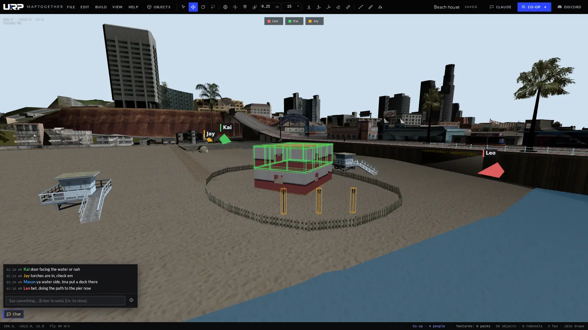
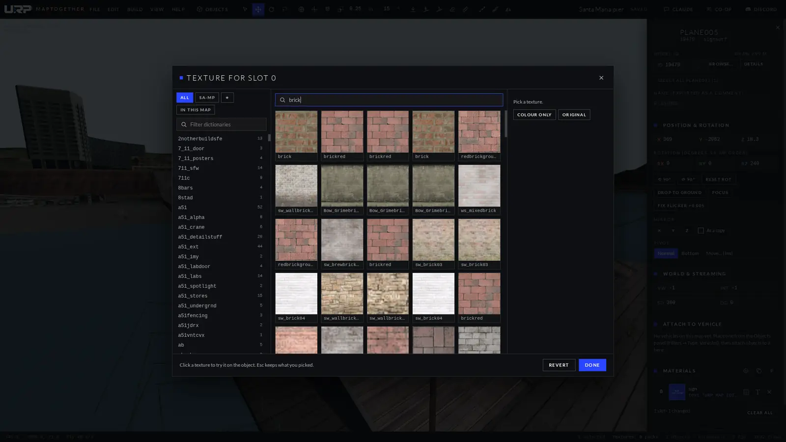
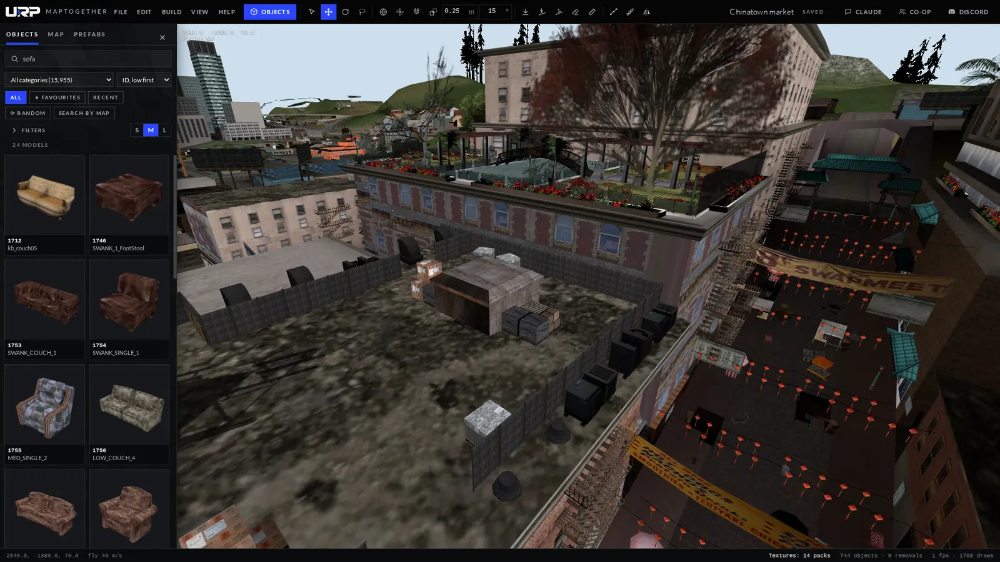
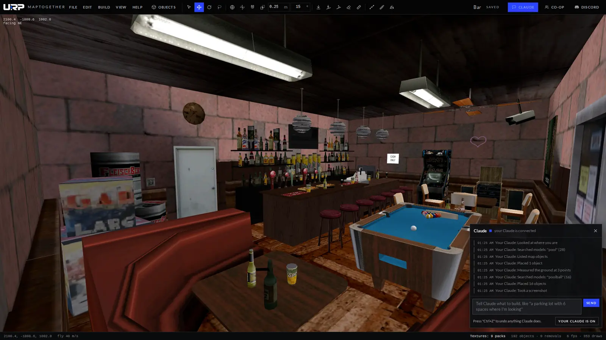

# MapTogether for SA-MP

A free map editor for SA-MP and open.mp. We originally made it for mappers on our own SA-MP server and figured other people could use it too.

**[Download it here](../../releases/latest)** for Windows or Android. It updates itself after that.

You point it at your GTA San Andreas folder and it loads the whole map from there. It doesn't come with any game files and nothing from your game gets uploaded.

- Co-op, meaning you and your friends can work on the same map at the same time
- Link up your own Claude account (the free version also works) and ask it to build for you
- A test button that starts a local open.mp server with your map in it
- Supports textures and material text
- Smart object browser with a preview of every model
- Room generator, placing along paths, arrays, stairs tools and much more
- Imports Pawn, Texture Studio and MTA maps
- Exports CreateDynamicObject and CreateObject code

You need Windows 10 or 11, GTA San Andreas for PC and the SA-MP or open.mp client. Windows will probably warn you the first time you open it. Press "More info" and then "Run anyway".

You need to link your Discord for co-op and Claude. The rest works without an account.

If you run into a bug let us know on [Discord](https://discord.gg/4dCqKAmYXw). This repo only has the downloads. MapTogether is not affiliated with Rockstar Games or Take-Two Interactive.
