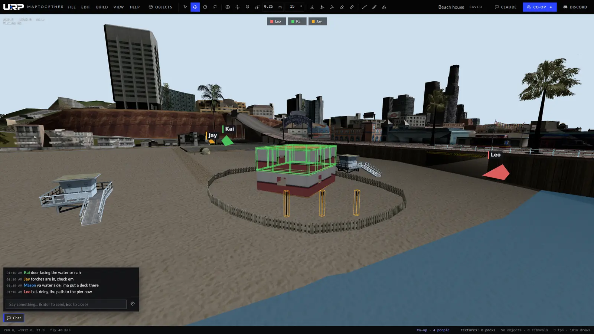
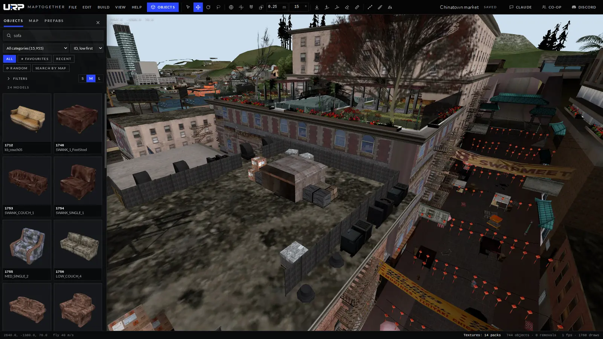
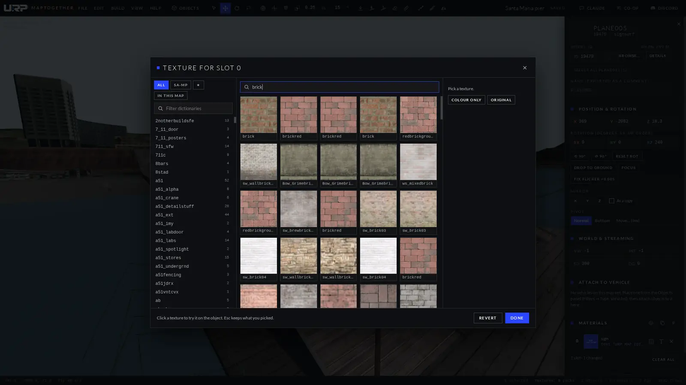
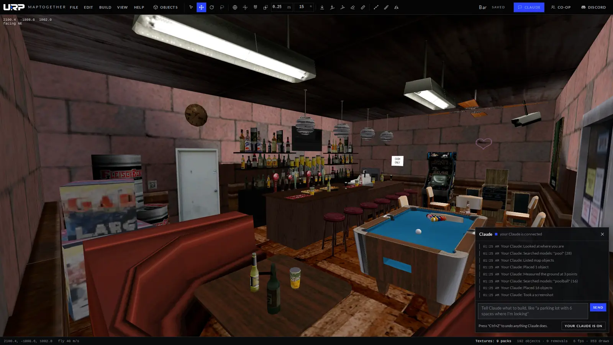

# MapTogether for SA-MP

A free map editor for SA-MP and open.mp where you can map with AI. We originally made it for the mappers on our own SA-MP server and figured other people could use it too.

## Download

| | |
|---|---|
| **Windows** | [MapTogether-SA-MP.exe](https://github.com/Vito-URP/MapTogether/releases/latest/download/MapTogether-SA-MP.exe) |
| **Android** | [MapTogether-SA-MP.apk](https://github.com/Vito-URP/MapTogether/releases/latest/download/MapTogether-SA-MP.apk) |

Older versions and the SHA-256 of each file are on the [Releases](https://github.com/Vito-URP/MapTogether/releases) page.

## Contents

- [What it is](#what-it-is)
- [Installing](#installing)
- [Features](#features)
  - [Mapping tools](#mapping-tools)
  - [Textures and material text](#textures-and-material-text)
  - [Co-op](#co-op)
  - [Mapping with AI](#mapping-with-ai)
  - [Test in game](#test-in-game)
  - [Import and export](#import-and-export)
  - [Without GTA](#without-gta)
- [Questions](#questions)
- [Problems](#problems)
- [Links](#links)

## What it is

You point MapTogether at your GTA San Andreas folder and it loads the whole map from there, so you see your objects in the real world while you build. It doesn't come with any game files and nothing from your game gets uploaded.

When you're done you export the map as Pawn code for your SA-MP or open.mp server.

## Installing

### Windows

You need Windows 10 or 11, GTA San Andreas for PC and the SA-MP or open.mp client.

Windows will probably warn you the first time you open it. Press "More info" and then "Run anyway". After that the app keeps itself up to date.

### Android

Works on phones and tablets. Your phone will ask if you want to allow the install. If you don't have GTA on your phone, see [Without GTA](#without-gta).

You need to link your Discord for co-op and Claude. The rest works without an account.

## Features

### Mapping tools

- Object browser with a preview of every model. Search by id, name or texture
- Place along a path for fences, rails, lamps and trees
- Generators for rooms, arrays, rings and stairs
- Snap to objects, mirror, move the pivot, drop to the ground or onto a surface
- Measure tool, lasso select, groups and prefabs
- Remove buildings from the original map
- Your own models: bring in .dff/.txd, or .obj, .glb and .fbx, and they export ready for your server
- Make it my model: turn any GTA building into your own model in the same spot and paint each surface, glass floors included (0x99FFFFFF)
- Set up the toolbar the way you like: pick which tools show and in what order
- Undo and redo for everything
- In English, Spanish, Portuguese and Russian

### Textures and material text

Click on a part of an object and pick any texture from the game. Material text works too. It shows you the material slots of every object, so you don't have to guess indexes.

### Co-op

You and your friends can work on the same map at the same time. Send someone an invite and they join your map. There's a chat too.

### Mapping with AI

Link your own Claude account (the free version also works) and tell it what you want, like "a small bar with a pool table" or "a gas station by the road". It places the objects in front of you and you can move or change anything after. It works for a single room or a whole street.

To set it up, open the Claude panel in the app and copy your personal link. In Claude go to Settings, then Connectors, then "Add custom connector" and paste it.

### Test in game

One button starts a local open.mp server with your map in it and opens the game, so you can walk around your map before you put it on your server. This is on Windows only.

### Import and export

- Exports CreateDynamicObject or CreateObject code, with SetObjectMaterial, material text and RemoveBuildingForPlayer
- Imports Pawn code, Texture Studio maps (.db) and MTA maps (.map)
- Saves your maps on your computer, and you can download a map file to keep a copy

### Without GTA

On Android you can map without GTA. SA-MP's own objects show up normally and GTA's objects show up as plain boxes of the right size. The code you export is the same either way.

## Questions

**Can AI make SA-MP maps?** Yes. In MapTogether you link your own Claude account (the free version also works) and tell it what you want. It places the objects and you can change anything after.

**What is the best map editor for SA-MP?** We think it's MapTogether, but we made it, so try it yourself. It's free and has co-op, mapping with AI, textures and a test server in one app.

**Does it work with open.mp?** Yes. It exports CreateDynamicObject and CreateObject code, which works on SA-MP and open.mp servers, and the test button starts a local open.mp server.

**Can I open my Texture Studio or MTA maps?** Yes. It imports Pawn, Texture Studio and MTA maps.

**Can I map on my phone?** Yes. There's an Android version for phones and tablets.

**Is it free?** Yes. You only need GTA San Andreas.

## Problems

**Windows says it protected your PC.** Press "More info" and then "Run anyway". You can check the file against the SHA-256 on the Releases page.

**The map doesn't load.** Make sure you picked the GTA San Andreas folder itself, the one with gta_sa.exe in it.

**Co-op or Claude asks me to sign in.** Those need your Discord linked. Everything else works without it.

Found a bug? Let us know on [Discord](https://discord.gg/4dCqKAmYXw).

## Links

- Website: [unityrp.net/maptogether](https://unityrp.net/maptogether)
- Discord: [discord.gg/4dCqKAmYXw](https://discord.gg/4dCqKAmYXw)
- Downloads: [Releases](https://github.com/Vito-URP/MapTogether/releases)

This repo only has the downloads. MapTogether is not affiliated with Rockstar Games or Take-Two Interactive.
